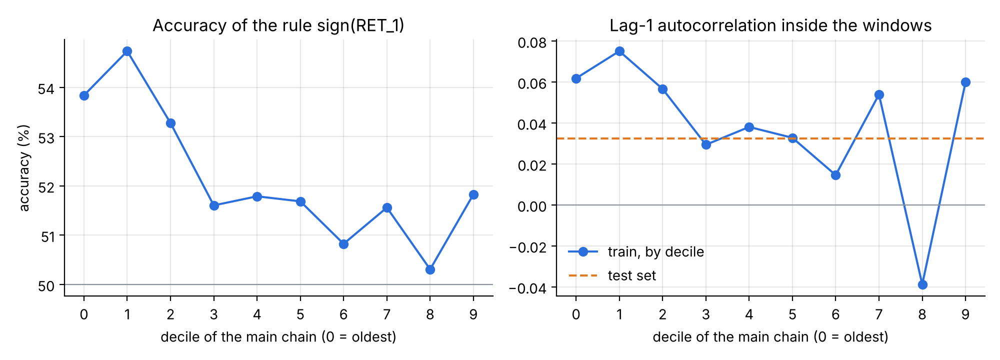
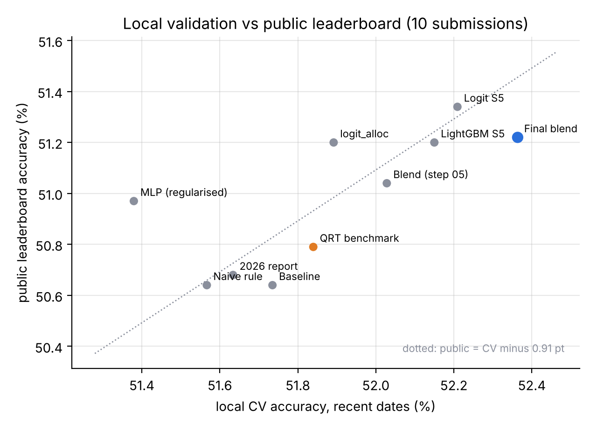

# QRT Challenge Data 167: predicting the sign of asset allocation returns

Each row of the dataset is an allocation (a long/short portfolio) on a given day. The task is to predict whether its return on the next day will be positive, using its last 20 daily returns, its last 20 signed volumes, its median daily turnover and an anonymous group. The metric is accuracy.

My final model scores **51.22% on the public leaderboard, against 50.79% for QRT's LightGBM benchmark**. It also beats the benchmark by 0.56 point on a held-out period that I opened only once, at the very end. On this problem a coin flip scores 50%.

The main work is about validation, not about models. The full write-up is in [`report/research_note.pdf`](report/research_note.pdf) (6 pages).

## Results

| Model | Local CV, recent dates | Lockbox (250 newest dates) | Public leaderboard |
|---|---|---|---|
| Naive rule: tomorrow has the sign of yesterday | 51.57% | 51.10% | 50.64% |
| QRT benchmark (LightGBM, 52 features) | 51.84% | 51.42% | 50.79% |
| Logistic baseline (10 features) | 51.73% | 51.53% | 50.64% |
| **Final blend (logistic + shallow LightGBM)** | **52.36%** | **51.98%** | **51.22%** |

## Three findings

**1. The dates are shuffled, and the true order can be rebuilt.** The labels `DATE_0001` to `DATE_2642` are not in calendar order. The 20-day windows overlap from one day to the next, so `RET_2` of a day should match `RET_1` of the day before across all allocations. Matching dates on this overlap gives back 4 chains of 1,780, 348, 256 and 130 consecutive days. Two checks independent of the matching confirm the order: the missing `SIGNED_VOLUME_1` values follow a 5-day cycle (a weekday indicator), and the universe grows from 65 to 276 allocations along the main chain, which gives the direction of time.

**2. The benchmark's optimism comes from non-stationarity, not leakage.** Purging the folds changes nothing for row-wise features. What changes the score is the period you score on: the signal (mostly lag-1 autocorrelation) weakens over time, and the test set looks like the most recent regime.



So every model here is judged on the recent regime only, with purged 60-day blocks, a decision rule fixed in advance (gain above 2 standard errors across 8 folds), and a lockbox. With this protocol, the local ranking of 10 submitted models matches the public ranking (Spearman 0.82, p = 0.003), with a stable gap of about 0.9 point.



**3. The extra accuracy comes from cross-sectional information, not model complexity.** What helped: allocation fixed effects with strong shrinkage, then what similar allocations and groups did the day before (top-5 correlated peers, group means, group-by-group lead-lag). What did not help: more flexible models (LightGBM alone, a neural network), recency weighting, nested hyperparameter tuning, or the extra features of my earlier ~80-feature pipeline. Linear, boosted and neural models all hit the same ceiling.

## Repository

| File | Content |
|---|---|
| `01_eda.ipynb` | Data exploration, discovery of the shuffled dates |
| `02_validation.ipynb` | Chronology reconstruction, signal decay, frozen folds and lockbox (saved to `artifacts/`) |
| `03_baseline.ipynb` | Naive rule, QRT benchmark and logistic baseline under the protocol |
| `04_allocation.ipynb` | Allocation fixed effects |
| `05_boosting.ipynb` | LightGBM and first blend |
| `06_final.ipynb` | Cross-sectional features, final model, lockbox, submission |
| `07_reseau.ipynb` | Neural network on the raw window (negative result) |
| `08_soumissions.ipynb` | Control submissions used to test CV against the leaderboard |
| `09_rapport_2026.ipynb` | Rebuild of my earlier (March 2026) pipeline, scored with the same protocol |
| `utils.py` | Shared code: data loading, chronology, folds, comparison rule, features |
| `report_pipeline.py` | Features and parameters of the earlier pipeline |
| `make_figures.py` | The two figures of the write-up |
| `artifacts/` | Reconstructed chronology, frozen folds, journal of fold scores for every model kept or submitted |

The notebooks are commented in French.

## Reproduce

```bash
pip install -r requirements.txt
```

Download `X_train.csv`, `y_train.csv`, `X_test.csv` and `sample_submission.csv` from [challengedata.ens.fr](https://challengedata.ens.fr/) (challenge 167) into a `data/` folder at the root. The data is not redistributed here. Then run the notebooks in order. Seeds are fixed. `02_validation` takes a few minutes, `06_final` and `09_rapport_2026` 5 to 10 minutes on a laptop.

## Limitations

The edge is small (about 2 points above a coin flip on the lockbox) and the signal it relies on has been decaying. The recent regime is identified through universe size, a proxy for calendar time. The order between the four chains is unknown. Scores near 81% on the public leaderboard cannot come from predicting daily return signs; I found no mechanism in the data that reproduces them and left them out of every comparison.
